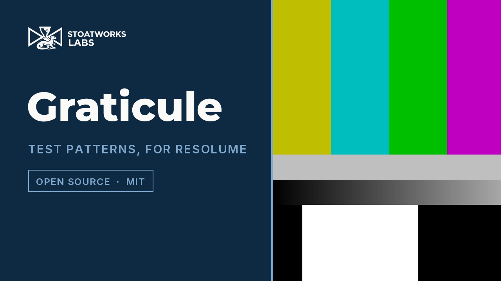

# Graticule

> **AI-assisted project.** This codebase was created with [Claude](https://claude.com/claude-code)
> (Anthropic), directed and reviewed by a human author. The claims are *measured* rather
> than taken on trust. The SMPTE bars are checked against a run-length analysis of ffmpeg's
> `smptehdbars` at four rasters (`gttest --bars`), and their fifteen colours are computed
> through Rec. 709 and land on the measured code values (`gttest --colours`). Every other
> pattern is rendered by the real plugin class in a real GL context and specific pixels are
> checked (`gttest --pixels`), all 69 controls are proven to change the picture
> (`tools/sweep.py`), and the bundle registers, instantiates and lights pixels in the
> fleet's oxbow host. On Windows it loads, registers and draws in Resolume Arena 7.27.1 on
> software rendering, and 68 of the 69 controls are seen changing the picture through Arena's
> own API. **On macOS it hasn't been dropped into a clip in Resolume yet.**

Test patterns and LED grids for Resolume, generated live at the output's own raster.

The static-image version of this is [Test Card](https://github.com/stoatworks-labs/test-card),
which renders a PNG per output from an imported output map. Graticule is the same patterns
as a Resolume source: drop it on a layer and it draws at whatever size Resolume hands it,
with a text burn-in, a moving marker and a frame counter, none of which a PNG can manage.

It's an FFGL source plugin for Resolume Arena and Avenue.

<!-- downloads:start -->

## Download

**[v0.1.0](https://github.com/stoatworks-labs/graticule/releases/tag/v0.1.0)** — prebuilt for macOS and Windows. Pick your platform:

<b>macOS</b> — Universal (Apple Silicon + Intel)

| Build | Download | Size |
| --- | --- | --- |
| Universal (Apple Silicon + Intel) · .dmg disk image | [`graticule-0.1.0-macos-universal.dmg`](https://github.com/stoatworks-labs/graticule/releases/download/v0.1.0/graticule-0.1.0-macos-universal.dmg) | 244 KB |
| Universal (Apple Silicon + Intel) · .zip archive | [`graticule-macos-universal.zip`](https://github.com/stoatworks-labs/graticule/releases/latest/download/graticule-macos-universal.zip) | 206 KB |

<b>Windows</b> — x64

| Build | Download | Size |
| --- | --- | --- |
| x64 · .exe installer | [`graticule-0.1.0-windows-x86_64-setup.exe`](https://github.com/stoatworks-labs/graticule/releases/download/v0.1.0/graticule-0.1.0-windows-x86_64-setup.exe) | 229 KB |
| x64 · .zip archive | [`graticule-windows-x86_64.zip`](https://github.com/stoatworks-labs/graticule/releases/latest/download/graticule-windows-x86_64.zip) | 126 KB |

All builds, checksums and release notes: [github.com/stoatworks-labs/graticule/releases](https://github.com/stoatworks-labs/graticule/releases).

macOS builds are signed and notarised and open normally. The Windows builds are unsigned, so SmartScreen warns once.

<!-- downloads:end -->

*[Watch it](https://www.youtube.com/watch?v=HAlnt-y3Ld4) — 59 seconds, silent: RP 219 at full
and legal range with the pluge brightened, the grids, the alignment chart's corner, LED cabinets
at P2.6, P2.9 and P3.9, the pixel check beside the same pixels through a 95% scale, and the
latency sweep. Rendered by `gttest --pipe`, not captured from Resolume; where a beat is about
single pixels it shows them enlarged, because the player is scaling the video.*

## Patterns

| Pattern | What it is for |
|---|---|
| **SMPTE RP 219** | Standard bars, +I/+Q, luma ramp and pluge. Geometry and colours measured from a real generator — see [Bars.h](source/Bars.h) |
| **75% / 100% bars** | Eight equal full-height bars. Survives being squeezed onto a narrow LED strip where RP 219's four rows would be unreadable |
| **Grid** | Your own pitch in pixels or a division count, heavy lines every N, cell labels, diagonals, centre target, origin at the corner or the centre |
| **Alignment** | 1px edge border, corner brackets with the pixel count, safe areas, centre target and circles, 1px checker patches |
| **LED Tiles** | One lettered cell per cabinet, with module lines inside each cabinet. Tile size, module size and origin are free integers, so a real wall's numbers go straight in |
| **Solid** | Flat colour at a chosen level, for dead pixels and uniformity |
| **Greyscale** | Continuous ramp or stepped wedge, optionally split into R, G, B and neutral |
| **Pixel Check** | 1px checkerboard beside 1px line bursts. If any of the three renders as flat grey on the real output, something in the chain is scaling |

Every line is a whole number of pixels and nothing is anti-aliased, on purpose: a soft edge
on the wall means a scaler in the chain, never the pattern.

## Beyond the PNG

- **Levels**: full range 0–255 (media server, GPU, HDMI full) or legal 16–235 (an SDI
  chain). At full range the −2% pluge patch clips to black and can't be judged; that's
  what full range means, and it's why the pluge is only meaningful on legal.
- **Motion**: a bar sweeping across or down, or a bouncing box, inverting whatever is under
  it so it's visible on every pattern. The default speed is exactly one crossing a second.
- **Frame Counter**: frame number and seconds in the burn-in. Film the wall and the monitor
  together and the offset between the two counters is the latency, to the frame.
- **Burn-in**: resolution, pattern name and your own text, in a 5×7 bitmap font drawn by
  the shader at an integer scale, so the text is as pixel-exact as the pattern under it.
  Position, size and a contrasting plate are controls.
- **Presets**: thirteen whole jobs in one dropdown: the bars at each range, grids by pitch
  and by division, the alignment chart, 500 mm cabinets at P2.6 / P2.9 / P3.9 and a
  500×1000 at P2.6, the wedge, the pixel check, and a latency sweep. Presets are an
  override: while one is selected the inspector's numbers for the columns it sets aren't
  the truth, because Resolume doesn't accept value events from a plugin.

## Browser demo

**<https://graticule-demo.stoatworks-labs.com/>** runs the plugin itself, not a port of it:
`source/Graticule.cpp` and everything it calls (the parameter table, the preset override,
the conversion of every control into whole pixels, the RP 219 layout and the 5×7 font),
with the FFGL SDK classes it uses, compiled unmodified to WebAssembly by
`demo/tools/build-wasm.sh` (emscripten) and drawing with its own GLSL in WebGL2. The panel
is read back from the plugin's own declarations. Since the whole point is pixels, the page
draws at your screen's own device pixels by default, one plugin pixel to one screen pixel,
and says under the picture whether the browser kept it that way; there's a "Scaled to fit"
setting for watching what a scaler does to the pixel check. The page is the host, and a
thin one: no input (it's a source), the browser's clock, and one GL entry point translated
for WebGL2 (`demo/wasm/gl_shim.cpp`). Twenty settings drawn by the page came out identical
to `gttest --out`, pixel for pixel, in Chrome on Apple's Metal; on Chrome's software
renderer two of them were one code value out where a level lands exactly half-way between
two. `tools/verify.sh` fails if `demo/shaders.js` or any input of the `.wasm` has drifted
from `source/`. It's a demo, not the plugin; the page lists everything it doesn't
reproduce.

## Installing

Copy `Graticule.bundle` (macOS) or `Graticule.dll` (Windows) into

    ~/Documents/Resolume Arena/Extra Effects        (or "Resolume Avenue")
    Documents\Resolume Arena\Extra Effects           (Windows)

then restart Resolume. It shows up under **Sources**.

## Building

    git submodule update --init --recursive
    cmake -B build -DCMAKE_BUILD_TYPE=Release
    cmake --build build
    ctest --test-dir build --output-on-failure
    cmake --install build          # into Arena's Extra Effects, macOS

The macOS build is universal (arm64 + x86_64) by default; add
`-DCMAKE_OSX_ARCHITECTURES=arm64` for a quicker development build. Windows needs GLEW from
vcpkg, and `.github/workflows/release.yml` has the full configure line.

`tools/verify.sh` runs everything the release job checks, locally, in a few seconds.

## Diagnostics

Graticule writes a plain-text log every time it runs:

    ~/Library/Logs/graticule/graticule.YYYY-MM-DD.log                     (macOS)
    %LOCALAPPDATA%\graticule\logs\graticule.YYYY-MM-DD.log                (Windows)
    ${XDG_STATE_HOME:-~/.local/state}/graticule/logs/graticule.YYYY-MM-DD.log

It records the build, the GL driver, what unit the host's clock turned out to be, which
pattern is drawing at what size, and any shader or texture failure. If you're filing a bug,
it's the single most useful thing to attach.

## Status

- Every pattern verified pixel by pixel through the real plugin class on macOS
  (`gttest --pixels`); the bars verified against ffmpeg's measured geometry at 1920×1080,
  3840×2160, 1280×720 and 2048×1080.
- The bundle registers, instantiates and renders 120 frames under oxbow.
- **Windows, in Resolume Arena 7.27.1** (win-lab: Mesa llvmpipe, no GPU): CI's MSVC build
  loads, registers as a source and draws at the composition's 1280×720, with all 75
  parameters as declared and a clean log. The fleet's Arena gate (plugin-bench
  `arena/expect/graticule.json`) passes, with 68 of the 69 controls changing the picture
  and none dead. Edge Border is the one it can't see: a 1 px line on the outermost pixels,
  which Arena's 320×240 thumbnail never samples.
- **macOS:** installed into Arena 7.27.1's Extra Effects on the development machine, but
  **never instantiated inside Arena there**.
- No real wall, projector or SDI chain has looked at it yet.
- The browser demo runs the plugin's own C++ and shaders as WebAssembly; see *Browser demo*.

<!-- attributions:start -->
This project is built on other people's work — see [ATTRIBUTIONS.md](ATTRIBUTIONS.md).
<!-- attributions:end -->

## Licence

MIT. See [LICENSE](LICENSE) and [ATTRIBUTIONS.md](ATTRIBUTIONS.md).
