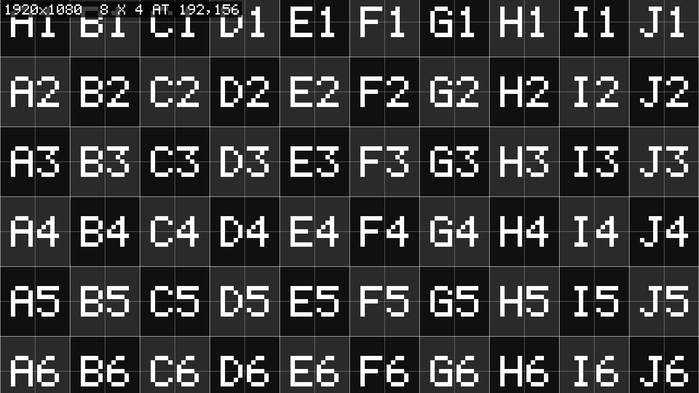
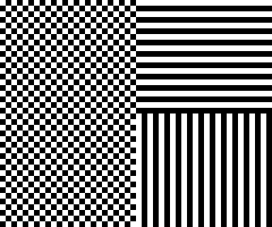

# Graticule user guide

Graticule is an FFGL source for [Resolume](https://resolume.com) Arena and Avenue that draws test
patterns and LED cabinet grids live, at whatever raster Resolume hands it: SMPTE RP 219 bars, plain
bars, a grid, an alignment chart, LED tiles, flat fields, a greyscale and a pixel check, with a
burn-in, a moving marker and a frame counter on top.

It's the live sibling of [Test Card](https://github.com/stoatworks-labs/test-card), which renders a
PNG per output from an imported output map. A PNG is drawn at the size you told it, and it sits
still. Graticule draws at the size it's actually given, says what that size was, and moves, so it
can tell you how many frames late the wall is as well as whether the wall is the shape you think.

Every line is a whole number of pixels and nothing is anti-aliased. If an edge on the wall is soft,
something between Resolume and the LEDs is scaling the picture, and it isn't the pattern.


*The defaults: SMPTE RP 219 at full range, with the resolution burnt in, at 1920 × 1080. Every
picture in this guide is a frame rendered through the plugin's own class by `gttest`, the offline
harness, rather than captured from Resolume.*

> **Before you rely on this:** it's at **v0.1.0**, the first release. On a Mac, every pattern has
> been checked pixel by pixel through the plugin's own class in a headless GL context, the RP 219
> bars against a measurement of ffmpeg's `smptehdbars` at four rasters, and all 69 controls are
> shown to change the picture. The bundle registers, instantiates and draws in the fleet's own test
> host, `oxbow`. On Windows it loads and draws in Resolume Arena 7.27.1, on software rendering
> with no GPU, and 68 of its 69 controls were seen changing the picture there. On a Mac it **hasn't
> been dropped into a clip in Resolume yet**. *What has been checked*, near the end, has the
> details. Try it on a spare layer before it goes anywhere near a show.
>
> This codebase was created with AI assistance, directed and reviewed by a human author.

---

## Installing

Every download carries one source, **SW Graticule**: `Graticule.bundle` on macOS, `Graticule.dll`
on Windows. Drop it into Resolume's effects folder and restart Resolume:

```
macOS    ~/Documents/Resolume Arena/Extra Effects/
Windows  %USERPROFILE%\Documents\Resolume Arena\Extra Effects\
```

Avenue uses the same layout under its own folder name. The plugin then shows up under **Sources**
as **SW Graticule**.

The macOS download is a universal build (Apple silicon and Intel), as a `.dmg` or a `.zip`. It's
Developer ID-signed and notarised, so the bundle just loads. The Windows download is an x64
installer or a `.zip`. It isn't code-signed, so the installer trips SmartScreen once: **More info**
→ **Run anyway**.

---

## The first five minutes

Put SW Graticule on a layer. It opens on SMPTE RP 219 bars at full range, with the size it's
drawing at burnt in at the top left.

1. **Read the burn-in.** That's the raster Resolume handed the plugin, and every line on every
   pattern is counted in its pixels. If it isn't the raster of the output you're testing, the
   picture is going to be scaled on its way out, and the patterns below will show it.
2. **Levels** to **Legal 16-235**. On a full-range monitor the bars look washed out, which is
   correct. Put it back to **Full 0-255** unless the output is going down an SDI chain (see *Full
   or legal*).
3. **Pattern** to **Pixel Check**, and go and look at the real screen, up close. The left half is a
   one-pixel checkerboard, the top right is one-pixel horizontal lines and the bottom right is
   one-pixel vertical lines. Any of the three gone flat grey means something is scaling.
4. **Preset** to **Alignment**. There's a one-pixel line round the very edge of the raster. A side
   of it missing on the screen is a side that's been cropped or overscanned.
5. **Preset** to **LED 500 mm P2.6**, or **Custom** with your own cabinet size in Tile Width and
   Tile Height (see *A worked example*).
6. **Preset** to **Latency sweep**, and film the wall and a monitor together (see *Measuring
   latency*).
7. **Preset** back to **Custom**, which hands every control back to the inspector.

That last step matters more than it looks. A preset keeps hold of seventeen controls for as long as
it's selected, whatever the inspector says (see *Presets*).

Most of the controls are numbers in real units, pixels, counts and percentages, declared to
Resolume as integers with their real ranges, so you type 192 rather than hunting for 0.0937 on a
slider. Arena reports them with their real ranges (Pitch 2 to 1024 and so on), though nobody has
yet looked at how its inspector draws them.
**Level** and **Speed** are ordinary 0-to-1 sliders. Each colour is one swatch, named for what it
colours (**Line Colour**, **Border Colour** and so on). Underneath it's three parameters, and
Resolume draws them as a single swatch under the red one's name; a host that doesn't do swatches
shows all three numbers, as Line Colour, Line Green and Line Blue.

---

## Full or legal

**Levels**, in the Pattern group, decides what black and white are on the output:

- **Full 0-255** (the default): black is 0 and white is 255. For the media server's own outputs,
  the GPU, and HDMI or DisplayPort set to full range.
- **Legal 16-235**: studio swing. Black is 16 and white is 235, and the codes below 16 and above
  235 are footroom and headroom. For an SDI chain that reads the numbers as studio swing.

Pick the one that matches what the far end of the chain expects, not the one that looks right on
your laptop. If a converter along the way already turns full range into studio swing, give it Full.

What the bars come out as, read off renders at 1920 × 1080:

| | Full | Legal |
| --- | --- | --- |
| black | 0 | 16 |
| pluge −2% | 0 | 12 |
| pluge +2% | 5 | 20 |
| pluge +4% | 10 | 25 |
| 15% grey | 38 | 49 |
| 40% grey | 102 | 104 |
| 75% white | 191 | 180 |
| 75% yellow | 191, 191, 0 | 180, 180, 16 |
| 100% white | 255 | 235 |

**Why the pluge only means anything at legal.** The pluge is the five narrow stripes in the bottom
row, right of the white block: −2%, black, +2%, black, +4%. You set a display's black level with
it, by bringing the brightness down until the −2% stripe vanishes into the black beside it while the
+2% stripe still just shows. That only works if −2% is a different number from black, and at legal
it is: 12 against 16. At full range there's nothing below 0, so −2% clips to 0 and is the same
black as its neighbours. The stripe has gone whatever the display does, so there's nothing to set
it against. That's full range working, and it's why there's a **SMPTE legal** preset.

Levels applies to everything that's a measurement: the bars, the solid fields, the greyscale and
the pixel check. The grid, the alignment chart and the LED tiles are drawn in the RGB you set in
their swatches, and Levels leaves them alone. Three things ignore it altogether:

- The **burn-in text** is always 255 white, so at legal it's super-white.
- The **plate** behind the burn-in darkens what's under it to a quarter, so on legal black (16) it
  makes 4, below black.
- The **marker** inverts what's under it, so it turns legal black into 239, above legal white.

None of that matters on a full-range output. On an SDI chain that's fussy about levels, turn the
burn-in and the marker off, or put up with three small illegal patches. If you want the grid or the
tiles at legal levels, set their colours yourself: 0.063 for black (16 of 255, which is what Tile A
Colour's default already is) and 0.922 for white (235).

---

## Every line is a whole pixel

A one-pixel line is one column of pixels and a three-pixel line is three. The diagonals and circles
are staircases of whole pixels rather than smooth curves, and the labels are a 5 × 7 bitmap font at
a whole-number scale, so each dot of a letter is a square of whole pixels as well. Apart from two
exceptions below, every pixel on every pattern is one of the colours you asked for.

So a soft edge, a grey fringe beside a line, or a line that's two pixels wide in some places and one
in others, means something in the chain is resampling the picture: a composition that isn't the
output's size, a scaled slice, a converter, a processor, or a display's own scaler.

The two exceptions: the LED tiles' module lines are half-way between the cabinet's fill and the
border colour, so they read as fainter than the cabinet edges, and the burn-in's plate is a quarter
of whatever is under it.

Three rules hold on every pattern:

- Pixels are counted from the top-left, which is 0, 0. At 1920 wide the last column is 1919.
- A line of odd width is centred on its position. An even width puts its extra pixel on the left
  (or above), so a two-pixel line at x = 100 covers 99 and 100.
- A line that falls on the raster's edge is pulled inside, so a border is never half off the
  screen. A three-pixel line at x = 0 covers 0 to 2, and one at the right-hand edge of a 1920 raster
  covers 1917 to 1919.

---

## The Pattern group

- **Preset:** **Custom** (the default) or one of thirteen factory jobs. While it's on anything but
  Custom it overrides seventeen of the controls below; see *Presets*.
- **Pattern:** which pattern draws: **SMPTE RP 219** (the default), **75% Bars**, **100% Bars**,
  **Grid**, **Alignment**, **LED Tiles**, **Solid**, **Greyscale** or **Pixel Check**. Each has its
  own group below, except the bars, which only have Levels. A pattern's group only acts on that
  pattern, so Pitch on the LED tiles does nothing, correctly. Motion and Burn-in work on all of them.
- **Levels:** **Full 0-255** (the default) or **Legal 16-235**. See *Full or legal*.

### SMPTE RP 219

Standard HD bars: 75% bars, +I and +Q, a luma ramp and the pluge, in four rows of 7/12, 1/12, 1/12
and 3/12 of the height. At 1920 × 1080 that's rows of 630, 90, 90 and 270 pixels, with 240-pixel
side blocks and the seven bars 205 or 206 pixels wide.

RP 219 itself is paywalled, and every free description of it is a redrawing of a redrawing, so the
geometry here isn't copied from one. It was measured. Test Card rendered ffmpeg's `smptehdbars` at
1920 × 1080, 3840 × 2160, 1280 × 720 and 2048 × 1080, run-length analysed the frames, and recovered
the band boundaries and the code values. All four sizes, the non-16:9 one included, agreed on the
same fractions, so the pattern is proportional: it stretches to whatever raster it's given rather
than pillarboxing, which on a media server is right, since the raster is the frame. The fifteen
colours are worked out from their R′G′B′ through the Rec. 709 matrix and land on the measured
values to the code value. +I and +Q are the NTSC chroma reference signals rather than colours, and
those two are carried as the measured numbers.

One difference from ffmpeg. ffmpeg rounds each bar up and dumps the remainder in the last column, so
its right-hand grey block can be up to 6 pixels narrower than its left. Graticule rounds each
boundary to the nearest pixel instead, which keeps the two side blocks the same width. The rows
match ffmpeg's to the pixel; a column edge can sit a few pixels from ffmpeg's.

The ramp in the third row runs from black at its left edge to white at its right, through the level
range.

### 75% Bars and 100% Bars

Eight equal bars, full height: white, yellow, cyan, green, magenta, red, blue and black. They aren't
RP 219, just the everyday colour bars, and they survive being squeezed onto a narrow LED strip where
RP 219's four rows would be unreadable. At **75% Bars** the white bar is at 75% as well, 191 at full
range and 180 at legal. At **100% Bars** everything's at full amplitude.

---

## The Grid group

Lines at a pitch you set in pixels, or a number of divisions that land on both edges, with heavy
lines every so many, diagonals, a centre target and, if you want them, a label in every cell.


*The Grid 100 px preset at 1280 × 720 with Cell Labels and Show Pattern on. Neither 1280 nor 720 is
a multiple of 100, so the right-hand and bottom edges get a heavy line of their own and the last
cells are short.*

- **Grid By:** **Pitch** (the default) or **Divisions**.
  - *Pitch* puts a line every Pitch pixels, counted from the top-left corner, or from the centre
    with Origin Centre on. Where the pitch misses the far edges, they get a heavy line anyway, so a
    100-pixel grid at 1920 wide ends in a column of cells only 20 pixels wide and a heavy line at
    1917 to 1919.
  - *Divisions* spreads Divisions X by Divisions Y cells over the raster, so the last line lands on
    the far edge whatever the raster. Each line is rounded to the nearest pixel, so where the raster
    doesn't divide evenly the cells differ by a pixel at most, rather than the last one taking all
    the slack.
- **Pitch:** 2 to 1024 pixels (default 100). Only read under Pitch.
- **Divisions X** and **Divisions Y:** 1 to 128 each (defaults 16 and 9). Only read under
  Divisions. At 1920 × 1080, 16 by 9 puts a line every 120 pixels both ways.
- **Line Width:** the ordinary lines and the diagonals, 1 to 16 pixels (default 1).
- **Major Every:** every how many lines is heavy, 0 to 32 (default 5; 0 for none). The count starts
  at the origin, so the first line is heavy: at the defaults that's the left and top edges, then
  every 500 pixels. Even at 0, an edge the pitch misses still gets its heavy line.
- **Major Width:** the heavy lines and the centre target, 1 to 16 pixels (default 3).
- **Diagonals:** corner to corner, in Line Colour at Line Width (default on). They're drawn first,
  so the grid crosses over them.
- **Centre Target:** a cross through the centre, the full width and height of the raster, and four
  circles round it, at a quarter, a half, three quarters and all of half the shorter side, so on a
  landscape raster the outer one touches the top and bottom (default on). Drawn in Major Colour at
  Major Width, on top of everything else. Circles that come out as ovals on the screen mean the
  picture has been stretched somewhere.
- **Origin Centre:** counts the pitch from the centre of the raster instead of the top-left
  (default off). There's then a heavy line through the middle both ways and the grid is symmetrical,
  with part-cells at all four edges: at 1920 × 1080 and the defaults, the lines fall at x = 60, 160
  … 1860 and y = 40, 140 … 1040. It does nothing under Divisions.
- **Cell Labels:** each cell's column and row, as `3,2`, counted from 1 at the top-left cell that
  touches the raster, in Major Colour in the middle of the cell (default off). They're sized to the
  cell, and left out when a cell is under 40 pixels either way, where they'd only be a smudge.
- **Line Colour:** the ordinary lines and the diagonals (default a mid blue, 61, 125, 255).
- **Major Colour:** the heavy lines, the centre target and the labels (default white). The alignment
  chart draws in it too.
- **Background:** the cells (default black). Also the alignment chart's background.

Levels doesn't touch any of these colours.

---

## The LED Tiles group

One cell per cabinet, in a checkerboard of two dark greys, with a white line at each cabinet's
edges, fainter lines where its modules meet, and a reference like `C4` in the middle. Put it on the
wall and you can see at a glance whether the processor's map puts every cabinet where the raster
thinks it is.

- **Tile Width** and **Tile Height:** one cabinet, in pixels, 4 to 2048 (default 192 by 192).
- **Module Width** and **Module Height:** the modules inside a cabinet, in pixels, 0 to 1024
  (default 96 by 96; 0 for no module lines). There's a one-pixel line at each multiple of the module
  size inside every cabinet, half-way between the cabinet's fill and Border Colour. A module as big
  as the cabinet draws nothing.
- **Origin X** and **Origin Y:** where the top-left corner of a whole cabinet sits in the raster,
  0 to 4096 (default 0, 0). Usually that's the wall's top-left cabinet.
- **Checker:** alternate cabinets in Tile A Colour and Tile B Colour (default on). Off, they're all
  Tile A.
- **Tile Labels:** a column letter and a row number in each cabinet, `A1` at the top-left, then
  `B1`, `C1` and on through `Z1` to `AA1`, the way a spreadsheet does it (default on). They're sized
  to about 70% of the cabinet's width and no more than half its height, drawn in Border Colour, and
  left out of a cabinet too small for one (under about 16 pixels wide for a reference like `A1`).
- **Border Width:** the cabinet edges, 0 to 16 pixels (default 1; 0 for none).
- **Tile A Colour:** default 16, 16, 16, which happens to be legal black.
- **Tile B Colour:** default 42, 42, 42.
- **Border Colour:** the edges and the labels, and, mixed half and half with the fill, the module
  lines (default white).

The cabinets fill the whole raster. There's no wall size: the pattern draws cabinets out to every
edge and the processor shows whichever ones it has been told to. It's uniform cabinets only, too;
for an irregular wall built from a real cabinet map, Test Card can import one from Pixel Peeker.

### A worked example: 500 mm at P2.6

A wall of 500 mm cabinets at 2.6 mm pitch. P2.6 is really 2.604 mm, so a cabinet is 500 / 2.604 =
192 pixels a side, and the four 250 mm modules in it are 96 pixels each. Ten cabinets across and
five down make a 5 m × 2.5 m wall of 1920 × 960 pixels, mapped at the top-left of a 1920 × 1080
signal.

That's the **LED 500 mm P2.6** preset with Origin X and Y left at 0. On Custom it's Pattern **LED
Tiles**, Tile Width and Tile Height **192**, Module Width and Module Height **96**.


*The LED 500 mm P2.6 preset at 1920 × 1080, with the wall's size typed into Text and Text Size at
4. The cut-off sixth row is the 120 pixels of signal below the wall.*

What it draws, read back off that render:

- Cabinet edges at x = 0, 192, 384 … 1728, and at y = 0, 192, 384, 576, 768 and 960. A one-pixel
  border is the first pixel of the cabinet to its right or below it, so cabinet B2 starts at 192,
  192 with its left column and top row white.
- One more edge line at x = 1919, the raster's last column, where the edge at 1920 has been pulled
  inside.
- Module lines 96 pixels into each cabinet (x = 96, 288, 480 …), at 136 on the darker cabinets and
  149 on the lighter ones.
- Below y = 960, a sixth row of cabinets 120 pixels high, which isn't on the wall. The processor
  never shows it.

In general, with the origin at 0, 0, the *n*th cabinet across starts at (*n* − 1) × Tile Width, and
the *m*th row down at (*m* − 1) × Tile Height.

On the wall, every cabinet should have its left-hand column and top row of LEDs lit white, the
labels should read A1 to J5 in order, and the fainter module cross should sit in the middle of each
cabinet. A cabinet mapped one pixel to the right loses the white line down its left side and grows
one down its right, beside its neighbour's, so you see a double line on one side of it and none on
the other. A cabinet showing somebody else's label is being fed from the wrong part of the raster.


*The same render, 128 pixels square from 176, 176, enlarged four times with no smoothing. Each white
line is one pixel; the grey module lines are one pixel at half strength.*

The other LED presets are the same arithmetic. A 500 mm cabinet at P2.9 is 500 / 2.976 = 168
pixels, and at P3.9 it's 500 / 3.906 = 128, each with 250 mm modules at half that. **LED 1000 mm
P2.6** is a 500 × 1000 mm cabinet, 192 × 384, with the same 96-pixel modules, two across and four
down. They're starting points. A real wall's numbers come off the processor's cabinet map, and Tile
Width and Tile Height are plain integers so that you can type them in.

### When the wall doesn't start at 0, 0

The letters and numbers count from the first cabinet that touches the raster's top-left corner, not
from the origin. With Origin X and Y at 0 those are the same cabinet. Move the origin in and the
strip between the raster's edge and the wall gets cabinets too, whole or part, and they take the
first letters and numbers. Test Card counts the same way, so the two agree.

Eight of the same cabinets across and four down make a 4 m × 2 m wall of 1536 × 768 pixels. Centred
in a 1920 × 1080 raster, its top-left corner is at Origin X = (1920 − 1536) / 2 = 192 and Origin Y
= (1080 − 768) / 2 = 156.



*LED 500 mm P2.6 with Origin X at 192 and Origin Y at 156, at 1920 × 1080. The wall is the
eight-by-four block from B2 to I5. Column A and row 1 are raster outside it.*

Read back off that render, the cabinet edges are at x = 0, 192 … 1728 and y = 156, 348, 540, 732
and 924. Column A is the 192 pixels to the left of the wall, and row 1 is the 156 pixels above it
(the bottom of a cabinet whose top is off the raster), so the wall's top-left cabinet reads **B2**
and the wall runs B2 to I5. If the processor calls that cabinet A1, every label on the wall is one
letter and one number ahead of it. Where the strip is a part-cabinet, its label may be cut off or
missing, but it still takes its letter.

---

## The Solid group

A flat field, for dead and stuck pixels, uniformity, and matching cabinets or projectors to each
other.

- **Field:** **White** (the default), **Black**, **Red**, **Green**, **Blue**, **Cyan**,
  **Magenta**, **Yellow**, **50% Grey**, **18% Grey** or **Custom**.
- **Level:** 0 to 1, the fraction of the field's full value (default 1). Red at 0.5 is half red:
  128, 0, 0 at full range, 126, 16, 16 at legal.
- **Custom Colour:** the field for **Custom** (default white), scaled by Level like the rest.

The field goes through Levels, so white is 255 at full range and 235 at legal. **50% Grey** is 128 at
full range and 126 at legal. **18% Grey** is 18% of the signal, 46 at full range. It's a number for
matching things against, not a photographer's grey card, which is 18% of the light and comes out a
good deal brighter once it's been gamma encoded.

A dead LED shows up on White and on each primary at full level, and a stuck one on Black. For
uniformity and matching, look at a grey or a white at a few levels as well as at full.

---

## The Greyscale group

A ramp or a stepped wedge from reference black to reference white, through Levels.

- **Steps:** 0 to 64 (default 11). 0 is a continuous ramp. 2 or more is a wedge of that many flat
  patches, each one a single code value. 1 is a black field with one white column at the far end,
  which isn't much use to anybody.
- **Vertical:** off (the default) runs black to white from left to right; on runs it top to bottom.
- **Per Channel:** splits the raster into four strips, neutral, red, green and blue, from top to
  bottom, or from left to right with Vertical on (default off).

The default eleven steps, read off the render:

| step | 1 | 2 | 3 | 4 | 5 | 6 | 7 | 8 | 9 | 10 | 11 |
| --- | --- | --- | --- | --- | --- | --- | --- | --- | --- | --- | --- |
| Full | 0 | 26 | 51 | 77 | 102 | 128 | 153 | 178 | 204 | 230 | 255 |
| Legal | 16 | 38 | 60 | 82 | 104 | 126 | 147 | 169 | 191 | 213 | 235 |

Steps that merge on the screen show where a display or processor crushes the blacks or clips the
whites. On the continuous ramp, bands much wider than one code value's worth (about 7½ pixels at
1920 wide, at full range) mean something in the chain is carrying fewer bits than the signal.

---

## The Pixel Check group

- **Cell:** the size of a checker square and the width of a line, 1 to 16 pixels (default 1).
- **Line Bursts:** on (the default), the left half is the checkerboard and the right half is lines:
  horizontal above the middle, vertical below it. Off, the whole raster is checkerboard.



*The Pixel check preset at 1280 × 720: 48 × 40 pixels from the middle, where the three parts meet,
enlarged eight times with no smoothing. Shrunk to fit a page or a preview window, all three turn
into flat grey, and so does anything that's resampled on its way to the screen.*

At Cell 1 it's the hardest picture there is to get through a scaler untouched, since every pixel is
the opposite of its neighbours. It's black and white through Levels. Look at the real screen up
close, rather than at a photo of it, because a camera makes moiré out of this all by itself:

- **All three intact:** nothing is resampling the picture.
- **The checkerboard and both bursts grey:** something is scaling both ways.
- **Only the horizontal lines (top right) grey:** something is scaling vertically, blending rows.
- **Only the vertical lines (bottom right) grey:** something is scaling horizontally.
- **A slow ripple across a burst**, grey in some places and crisp in others: scaling by a ratio
  close to 1, which is a pixel or two out somewhere, such as a 1920 picture squeezed into 1918.

---

## The Alignment group

An alignment chart: an edge border to show the raster isn't cropped, corner brackets of a length
you can measure, safe areas, a centre target, and checker patches that go grey under a scaler.


*The Alignment pattern at its defaults, 1920 × 1080.*

- **Edge Border:** a one-pixel line on the outermost row and column, all four sides (default on).
  It's drawn last, so nothing covers it. A side missing on the screen has been cropped or
  overscanned.
- **Corner Markers:** an L-shaped bracket three pixels thick in each corner, fully inside the
  raster, with the length of its arms written beside the bottom-left one, as `100px` (default on).
- **Corner Size:** the length of the brackets' arms, 8 to 1000 pixels (default 100). Measure one on
  the screen and you have pixels to millimetres.
- **Centre Marks:** a one-pixel cross through the centre and four circles, like the grid's Centre
  Target (default on). Ovals mean a stretch.
- **Safe Area A %** and **Safe Area B %:** two one-pixel rectangles, each inset by that percentage
  of the width and height, split between the two sides, and labelled at its bottom-left with the
  area it encloses (defaults 10 and 20, labelled 90% and 80%; 0 for none, up to 49). At 1920 × 1080,
  10 puts the edges at x = 96 and 1823 and y = 54 and 1025. 90% and 80% are the old action-safe and
  title-safe; for the 93% and 90% that SMPTE ST 2046-1 gives for HD, set 7 and 10.
- **Pixel Patches:** four single-pixel checkerboards, a twentieth of the shorter side square (54
  pixels at 1080, never under 16), a quarter and three quarters of the way across and down (default
  on). Like the pixel check, they go flat grey under a scaler.
- **Diagonal Cross:** one-pixel diagonals from corner to corner (default on).

The chart has no colours of its own. It draws in the Grid group's **Major Colour** on its
**Background**, and Line Colour isn't used. Its labels sit at the bottom-left of whatever they
label, so the burn-in, which defaults to the top-left, doesn't cover them.

---

## The Motion group

- **Marker:** **Off** (the default), **Sweep Across**, **Sweep Down** or **Bounce**.
  - *Sweep Across* is a bar Marker Size wide and the full height of the raster, travelling left to
    right. It starts just off the left-hand edge, finishes just off the right, and starts again.
  - *Sweep Down* is the same bar on its side, the full width, travelling top to bottom.
  - *Bounce* is a box Marker Size square, bouncing round the raster. It goes from side to side at
    the crossing rate and up and down at 0.7 of it, so it wanders over the whole raster rather than
    retracing one diagonal.

  The marker inverts whatever is under it (each value becomes 255 minus itself), so it shows on
  every pattern and every field. The burn-in sits on top of it.
- **Speed:** crossings a second, as a power of two along the slider: an eighth of a crossing a
  second at 0, one at 0.5 (the default) and eight at 1, doubling every sixth of the slider, so half
  a crossing a second at 0.333, two at 0.667 and four at 0.833. At the default a sweep takes one
  second to cross the raster, which is the number a latency measurement wants to count against.
- **Marker Size:** 1 to 256 pixels (default 16).
- **Frame Counter:** adds a line to the burn-in like `F000045  0.75s`, which is the number of frames
  this clip has drawn since it was created, in six digits that go round after 999,999, and the
  seconds on its clock, to two decimal places (default off). It shows even with Burn-in off, and
  takes its position, size and plate from the Burn-in group.

A bar crossing sideways is also the quickest way to spot tearing. If part of the screen is showing
a different frame from the rest, the bar comes out with a step in it.

**The clock.** The marker and the seconds run on the host's clock. FFGL doesn't say what unit a host
sends its time in, and Resolume sends milliseconds where an offline harness sends seconds, so the
plugin works out which by comparing the host's time with a real clock over its first few frames.
Until it has decided, it runs on its own clock from when it started drawing, so the seconds can jump
to the host's time a moment after the clip starts. The log says which unit it settled on.

### Measuring latency

The **Latency sweep** preset is the grid with a bar crossing it once a second and the frame counter
on.


*The Latency sweep preset at 1280 × 720, 45 frames in at 60 frames a second. The bar is three
quarters of the way across, three quarters of a second into its crossing.*

1. Put the same clip on the wall and on a monitor whose delay you trust to be small, such as one
   plugged straight into the server's GPU.
2. Film both in one shot, with a camera or a phone, at the fastest shutter you can get away with,
   so that each frame of footage catches one frame on each screen rather than a blur of two.
3. Step through the footage a frame at a time and read both counters off the same frame of footage.
   The difference between the frame numbers is how many frames the wall is behind the monitor. The
   difference between the seconds is the same thing in time, which is handier when the output's
   refresh rate isn't the composition's frame rate.
4. Do it a few times and take the most common answer. The camera's frames don't line up with either
   screen's, so any one reading can be a frame out either way.

The bar gives you a second reading when a counter is hard to read off a wall. At one crossing a
second on a 1920-pixel raster it moves (1920 + 16) / 60, about 32 pixels, a frame at 60 frames a
second, so the gap between the bar on the two screens in pixels, over 32, is the delay in frames.

What that measures is the delay between the two screens, in frames the composition rendered, so if
the monitor has a delay of its own, the answer is the wall's delay on top of it. The counter counts
the frames one clip has drawn, so both screens have to be showing the same clip; two clips of SW
Graticule count separately.

---

## The Burn-in group

- **Burn-in:** the first line of text, on or off (default on). The frame counter's line has its own
  switch, Frame Counter, in the Motion group.
- **Show Resolution:** the raster the plugin is drawing at, as `1920x1080` (default on). That's the
  size Resolume handed it, so it's the first thing to read when a line looks soft.
- **Show Pattern:** the pattern's name, as `LED TILES` (default off).
- **Text:** your own text, after the resolution and the pattern name (default empty). Printable ASCII
  only: anything else comes out as a `?` for each byte, so `Café` reads `Caf??`. The whole line,
  resolution and pattern name included, stops at 40 characters.
- **Position:** **Top Left** (the default), **Top Centre**, **Centre**, **Bottom Centre** or
  **Bottom Left**, 2 × the text size + 4 pixels in from the edges. There are no right-hand positions.
- **Text Size:** the font's scale, 1 to 16, or 0 (the default) to take it from the raster: the
  shorter side over 180, rounded, which is 4 at 720, 6 at 1080 and 12 at 2160. Each letter is 5 × 7
  squares that many pixels across, and lines are 8 squares apart.
- **Plate:** a dark plate behind the text, darkening whatever is under it to a quarter (default on).
  It isn't opaque, so the pattern still shows through, dimmed.

The text is white, 255, whatever Levels says. Each dot of a letter is a whole-pixel square, so the
burn-in is as much a pixel test as the pattern under it: soft letters mean scaling as surely as soft
lines do.

By default the burn-in sits over the top-left of the raster, which is where cabinet A1, the grid's
first cell and the top-left corner bracket are. Move it with Position, or turn it off, when those
are what you need to see.

---

## Presets

**Preset** picks a whole job in one go. Each one sets the pattern and the controls that decide its
geometry, and leaves the colours, line widths, switches, origin and burn-in to you.

| Preset | What it sets |
| --- | --- |
| **SMPTE RP 219** | The bars at full range. The same as the defaults. |
| **SMPTE legal** | The bars at legal range, for an SDI chain, where the pluge means something. On a full-range monitor it looks washed out, correctly. |
| **75% bars** | Eight equal 75% bars, full height, for a narrow strip where RP 219's rows would be unreadable. |
| **Grid 100 px** | A 100-pixel pitch with every fifth line heavy: count the heavy lines and you have the raster in five hundreds. |
| **Grid 16 x 9** | 16 by 9 divisions with no heavy lines, so the last line lands on the far edge whatever the raster. |
| **Alignment** | The alignment chart. |
| **LED 500 mm P2.6** | 192 × 192 cabinets with 96 × 96 modules. |
| **LED 500 mm P2.9** | 168 × 168 cabinets with 84 × 84 modules. |
| **LED 500 mm P3.9** | 128 × 128 cabinets with 64 × 64 modules. |
| **LED 1000 mm P2.6** | 192 × 384 cabinets (500 × 1000 mm) with 96 × 96 modules. |
| **Grey 11-step** | The eleven-step wedge at full range. |
| **Pixel check** | The pixel check at one-pixel cells. |
| **Latency sweep** | Grid 100 px, with a 16-pixel bar sweeping across once a second and the frame counter on. |

Every preset sets all seventeen of these, either to the values in the table or to their defaults:
**Pattern**, **Levels**, **Grid By**, **Pitch**, **Divisions X**, **Divisions Y**, **Major Every**,
**Tile Width**, **Tile Height**, **Module Width**, **Module Height**, **Steps**, **Cell**,
**Marker**, **Speed**, **Marker Size** and **Frame Counter**.

### A preset is an override

Resolume doesn't accept value changes from a plugin, so a preset can't move the inspector's
controls to its own values. Instead, while Preset is on anything but **Custom**, the plugin reads
the preset's value for each of those seventeen controls every frame and ignores the inspector's. So
while a preset is selected:

- **The inspector's numbers for those seventeen aren't what's drawing.** With LED 500 mm P2.9
  selected, Tile Width can say 192 all day long; the cabinets are 168.
- **Changing one of them does nothing.** Switching Frame Counter on, choosing a Marker or setting
  Levels to Legal does nothing on screen under any preset but Latency sweep (or SMPTE legal, for
  Levels).
- **Everything else still works**: the colours, Line Width, Border Width, Origin X and Y, the
  alignment switches and the whole Burn-in group.

To change a preset's numbers, type them into the controls yourself and set Preset to **Custom**.
Custom hands every control back to the inspector, which means you get whatever the inspector says,
not the preset you were just looking at: if Pattern there still says SMPTE RP 219, you're back on
the bars. So a legal-range wedge, a pixel check with two-pixel cells, or the alignment chart with a
sweep across it, are all jobs for Custom.

---

## The About group

The last group, **About**, has the plugin's name, version, licence and maker (`Graticule v0.1.0 -
MIT - Stoatworks Labs, stoatworks-labs.com`), and four buttons that open this guide, the project
page, the source on GitHub and the support page in your browser.

---

## If it looks wrong

**A line is soft, doubled or uneven, or the pixel check has gone grey.** Something between the
plugin and the screen is resampling the picture. Read the burn-in's resolution first. If it isn't
the output's raster, the picture is being scaled on its way out of Resolume. If it is, look further
down the chain: a slice scaled in the output map, a converter, a processor, or the display's own
scaler. The pixel check's bursts say which way it's being scaled (see *The Pixel Check group*).

**One side of the alignment chart's edge border is missing.** That side is cropped or overscanned.
Look at the display's overscan or aspect setting and the slice's edges in the output map.

**The circles are ovals.** The picture has been stretched one way: an aspect ratio wrong in the
output map, or something along the chain treating the pixels as other than square.

**The bars look washed out and grey.** Legal range on a full-range display. That's correct if it's
what you meant; if not, Levels to Full.

**The pluge's −2% stripe is invisible.** At full range it always is (see *Full or legal*). If the
+2% and +4% stripes have gone as well and the blacks look crushed, either the display's black level
is too low or a full-range picture is going into something that expects legal.

**A control does nothing.** A preset is selected and the control is one of the seventeen it sets
(see *Presets*). Or the control belongs to another pattern: Pitch does nothing on the LED tiles. Or
you're on the alignment chart, whose colours are the Grid group's Major Colour and Background.

**Frame Counter or the marker won't come on.** A preset other than Latency sweep is selected. Set
Preset to Custom.

**The frame counter stays on with Burn-in off.** It has its own switch, Frame Counter, in the
Motion group.

**The marker is a strobe rather than one crossing a second.** For its first few frames the plugin
is still working out what unit the host's clock is in. If it carries on, the log's `host clock is`
line says what it decided, and that's worth a bug report.

**The cabinet labels don't match the processor's.** The origin isn't at 0, 0, and the cabinets
between the raster's edge and the wall have taken the first letters and numbers (see *When the wall
doesn't start at 0, 0*).

**There are cabinets past the edge of the wall.** There always are. The pattern fills the raster
and doesn't know where the wall ends; the processor only shows the part it has mapped.

**There are no labels.** The cells or cabinets are too small for them. Grid labels need cells of
at least 40 pixels both ways, and a cabinet needs to be about 16 pixels wide for a reference like
`A1`.

**The text is full of question marks.** The burn-in is printable ASCII only, so accents and symbols
come out as `?`.

**The text stops partway.** A burn-in line is 40 characters at most, counting the resolution and
the pattern name.

**SW Graticule isn't under Sources.** Check the folder under *Installing*, and that Resolume was
restarted.

**The clip stays black, or won't load.** That's what a shader that won't compile looks like, or a
font texture the driver refused. Which one it was is in the log.

### The log

Graticule writes a plain-text log whenever it runs:

```
macOS    ~/Library/Logs/graticule/graticule.YYYY-MM-DD.log
Windows  %LOCALAPPDATA%\graticule\logs\graticule.YYYY-MM-DD.log
```

There's a file per day, named for the day Resolume loaded the plugin. It records the build when the
plugin loads; the GL vendor, renderer and version as each clip sets itself up; whether the pattern
shader wouldn't compile or the font texture wouldn't upload, with the GL error; what unit the host's
clock turned out to be in; and a line whenever a clip starts drawing a different pattern, size or
level range, such as `drawing GRID at 1920x1080 full range`. Each clip's lines are tagged with its
own number, `[1]`, `[2]` and so on, so that several clips don't read like one very confused one. It
writes when something changes rather than every frame, so a wall that's been black for an hour is
one line, not a hundred and eighty thousand.

If you're reporting a bug, it's the most useful thing to attach.

---

## Known limits

- **It hasn't run inside Resolume on a Mac yet**, and on Windows only on software rendering; see
  *What has been checked*.
- **The cabinet labels count from the raster's corner**, not from the origin, so a wall that
  doesn't start at 0, 0 doesn't start at A1.
- **Uniform cabinets only.** One cabinet size and one origin, filling the raster: no irregular
  walls, gaps, chain order or wall size. Test Card imports a real cabinet map.
- **The burn-in text, its plate and the marker ignore Levels**, so at legal range they put
  super-white and sub-black on the output.
- **The grid, alignment and tile colours ignore Levels**, so at legal range they need setting by
  hand.
- **While a preset is selected the inspector is wrong** about the seventeen controls the preset sets.
- **One line of your own text**, 40 characters including the resolution and pattern name, in
  printable ASCII, and no right-hand burn-in positions.
- **18% Grey is 18% of the signal**, not a grey card.
- **The bars stretch to any aspect ratio.** There's no pillarbox for a 4:3 or a very narrow raster;
  on a strip, use 75% Bars.
- **Steps at 1** is a black field with a white edge, not a wedge.
- **The frame counter goes round after 999,999 frames**, about four and a half hours at 60 frames a
  second.
- **Checked on one Mac**, an Apple M4 Max on macOS 26.4.1, through Apple's OpenGL 4.1 on Metal.
- **The browser demo is the plugin's code, not the plugin.** It runs Graticule's own C++ and
  shaders in your browser at
  [graticule-demo.stoatworks-labs.com](https://graticule-demo.stoatworks-labs.com), with the
  browser standing in for Resolume.

---

## What has been checked

Everything here ran on an Apple M4 Max under macOS 26.4.1, through `gttest`, the offline harness. It
drives the plugin's own class, the code Resolume loads, in a headless OpenGL context (Apple's GL 4.1
on Metal) and reads the pixels back.

- **The pixels.** `gttest --pixels` makes 61 checks on specific pixels of every pattern, mostly at
  640 × 360: the bars' colours at both ranges and the ramp; the grid's lines at their pitch, a
  one-pixel line one pixel wide, a heavy line three wide and the edges pulled inside; the alignment
  chart's border, brackets, safe areas and patches; the cabinet borders, checker, module lines and
  an offset origin; the solid fields, the wedge, the ramp and the pixel check; and the marker, the
  plate, the burn-in, Position and a frame counter that changes every frame.
- **The bars.** `gttest --bars` lays RP 219 out at 1920 × 1080, 3840 × 2160, 1280 × 720 and
  2048 × 1080 and checks it against the measurement of ffmpeg's `smptehdbars` at the same four
  sizes: every row boundary the same, every column within 8 pixels, every band the measured colour
  or the ramp, the bands tiling the raster with no gap or overlap, and the side blocks equal. 61
  checks. `gttest --colours` shows the fifteen computed colours land on the measured code values, and
  that the −2% pluge clips to 0 at full range and survives as 12 at legal. 24 checks.
- **Every control does something.** `tools/sweep.py` renders each of the 69 controls at both ends
  of its range, on the pattern that reads it, and none comes out dead. Text is left out (the burn-in
  pixel checks prove it draws), and so are the About buttons, which would open a browser. The sweep
  checks itself as well: the same render first and last in a batch must match, a control the
  pattern doesn't read must come out dead, and a batch render must match one through the host's own
  draw call.
- **The presets.** `gttest --defaults` shows the first preset is the plugin's defaults, that a
  preset overrides the controls it sets and that Custom hands them back; `tools/check_presets.py`
  checks every row is the right width and kind.
- **In a host.** The universal bundle registers, instantiates and renders 120 frames in `oxbow`, the
  fleet's FFGL test host.
- **In Resolume on Windows.** The x64 build loads, registers as a source and draws in Resolume Arena
  7.27.1 on win-lab, a Windows machine with no GPU (Mesa's llvmpipe does the rendering), at the
  composition's own 1280 × 720. All 75 parameters, the About block included, are there with the
  names, order, types, ranges and defaults declared, and Arena's log stays clean. The fleet's Arena
  check then moves each control through Arena's own REST API and watches the clip's thumbnail: 68
  of the 69 changed the picture there and none read dead. The one left out is Edge Border, whose
  1-pixel line sits on the outermost pixels, which Arena's 320 × 240 thumbnail never samples. On the
  first run Module Width and Module Height read dead for the same reason (at the module size
  checked, every module line fell between the pixels the thumbnail reads), and a module of 5 px
  showed them working. Software rendering says nothing about a GPU or about speed.
- **This guide.** Every number and picture in it was read off a render of the current build: the
  LED examples' edges and module lines, the code values in the tables, the marker's position and
  speed, the burn-in's limits and the preset override.

What hasn't been checked:

- **Resolume on macOS.** The bundle has been in Arena 7.27.1's Extra Effects folder on my Mac since
  September and has never been dropped into a clip. Its panel in Resolume, Resolume's clock driving
  the marker, and the raster Resolume hands it are all untried there.
- **Resolume on a GPU, or on Windows with one.** Arena has only run it on software rendering.
- **A real wall, projector or SDI chain.** The patterns are right as pixels. What a particular
  processor or display does with them is the thing they're for, and none has been looked at
  through one yet.

---

## Links

- User guide: [stoatworks-labs.com/software/graticule/guide](https://stoatworks-labs.com/software/graticule/guide/)
- Project page: [stoatworks-labs.com/software/graticule](https://stoatworks-labs.com/software/graticule/)
- Source: [github.com/stoatworks-labs/graticule](https://github.com/stoatworks-labs/graticule)
- Test Card, the PNG version: [github.com/stoatworks-labs/test-card](https://github.com/stoatworks-labs/test-card)

## Reporting something

If something's wrong, shout at
[github.com/stoatworks-labs/graticule/issues](https://github.com/stoatworks-labs/graticule/issues).
A photo of the screen, the pattern and preset, any controls you moved, the resolution in the
burn-in, the composition's frame rate, and what's between Resolume and the screen are usually
enough. If the clip stayed black, attach the log.
